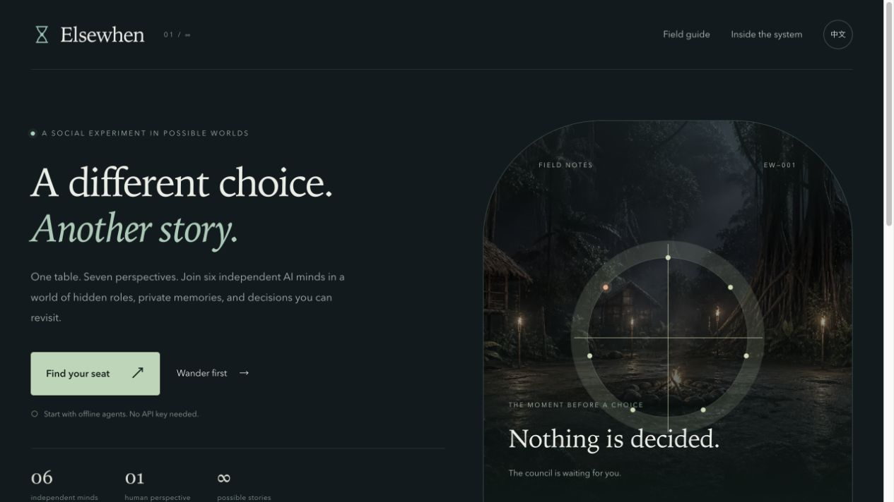

# Elsewhen

**换一个选择，走向另一个故事。**

Elsewhen 是一个可参与、可观察、可回溯的多智能体游戏。你与六个独立 AI 智能体共同参与隐藏身份议会，每个席位拥有自己的角色、记忆、行为策略和信息边界。游戏之外，还能探索森林、对比模型、查看关系变化，并从历史节点尝试另一种选择。

默认使用离线 Mock 智能体，无需 API 密钥。真实模型在开局前经过可用性与工具调用检查。

## 2026 上海开源软件应用创新大赛

参赛方向为**开源 AI 工具赛道**：可参与、可观测、可回溯的多智能体实验工具。

- [作品介绍与验证说明](docs/competition/os2026.md)
- [作品介绍 PDF](https://github.com/elsewhere-high/Elsewhen/releases/download/os2026-submission-v1/Elsewhen-OS2026-Project.pdf)
- [演示视频 MP4](https://github.com/elsewhere-high/Elsewhen/releases/download/os2026-submission-v1/Elsewhen-OS2026-Demo.mp4)
- [完整材料 Release](https://github.com/elsewhere-high/Elsewhen/releases/tag/os2026-submission-v1)

视频使用本地生产模式与离线 `mock-v1`，展示配置、议会操作、执行图、状态检查、复盘分支和批量实验。真实模型性能不由 Mock 演示结果推断。

## 本地启动

需要 Conda、Node.js 22.18+、pnpm 12 和运行中的 Docker Desktop。Python 统一运行于 `elsewhen` Conda 环境；Docker 只运行 PostgreSQL。

```bash
./setup.sh
./start.sh
```

- 网页：<http://127.0.0.1:4317>
- API 与接口文档：<http://127.0.0.1:8317/docs>
- 日志：`.run/backend.log`、`.run/frontend.log`
- 停止：`./stop.sh`，保留游戏数据库。

启动脚本只管理本项目记录的进程，不会终止占用端口的其他程序。游戏数据库使用本机端口 `55437`，测试数据库使用 `55438`。

## 玩法与实验

1. 在 **Find your seat / 找到你的席位** 中配置角色、模型和人类席位。
2. 保持默认 Mock 可直接开始。进入议会页面后点击 **Start Game**。
3. 按提示发言、投票，或执行身份允许的夜间行动。
4. 使用图、状态检查器、私人笔记和信任矩阵观察智能体行为；多人房间按席位隔离秘密信息。
5. 结束后检查复盘、学习报告和可回溯节点；模型实验室可批量比较不同配置。

浏览器探索模式位于 `/explore`：WASD 移动，F 切换提灯，E 交互，J 查看日志。音效由用户手势启用；减少动态效果设置会限制动画。

## 配置

`setup.sh` 首次创建 `backend/.env` 与 `frontend/.env.local`，不会覆盖已有配置。

| 配置 | 用途 |
| --- | --- |
| `OPENAI_API_KEY` | OpenAI 智能体及可选语音、转写、角色图片生成 |
| `ANTHROPIC_API_KEY` | Claude 智能体 |
| `GOOGLE_API_KEY` | Gemini 智能体 |
| `OLLAMA_BASE_URL` | 本地 Ollama 服务 |
| `OLLAMA_API_KEY` | Ollama Cloud |
| `GAME_HISTORY_ACCESS_KEY` | 运营历史档案访问密钥 |
| `NEXT_PUBLIC_API_URL` | 前后端分离部署时的显式 API 地址；本地留空 |

真实模型、语音和图片生成遵循对应服务的账户与计费规则；Mock 不访问模型服务。图片输入只在用户主动提交时发送，原始照片不会作为角色资源保存。真实密钥不应提交到 Git。

## 验证与生产模式

```bash
./check.sh
```

该命令启动独立测试数据库，运行后端测试、前端检查、探索与状态差异测试以及生产构建。测试会清理专用数据库；`TEST_DATABASE_URL` 必须明确指向名称以 `_test` 结尾的数据库。

生产模式本地启动：

```bash
./stop.sh
pnpm --dir frontend build
ELSEWHEN_MODE=production ./start.sh
```

## 工程结构

| 目录 | 内容 |
| --- | --- |
| `backend/app` | FastAPI、LangGraph、MCP、权限与持久化 |
| `backend/tests` | 信息隔离、游戏流程、工具调用、回溯、语音等测试 |
| `frontend/app` | 页面、元信息与全局样式 |
| `frontend/components` | 议会、探索、状态检查器与实验工具 |
| `frontend/public` | 图像、模型、音效和公开许可证 |
| `unreal/Elsewhen` | 可选 Unreal 原生客户端 |
| `art/werewolf`、`scripts/blender` | 可编辑角色模型与作者工具 |

进一步说明：[开发与架构](docs/development.md)、[API 与权限](docs/api.md)、[原生客户端](unreal/README.md)。

Unreal 客户端需要额外安装 Unreal Engine 5.8；森林中的真实模型对话需要服务端凭据。浏览器主应用不依赖 Unreal 或 Blender。

## 许可

Copyright (C) 2026 Ustinian5。项目采用 [AGPL-3.0-only](LICENSE)。第三方软件、人物扫描、环境资源与音效的声明见 [THIRD_PARTY_NOTICES.md](THIRD_PARTY_NOTICES.md)。

参与维护请参阅 [贡献指南](CONTRIBUTING.md)。

## 界面预览


